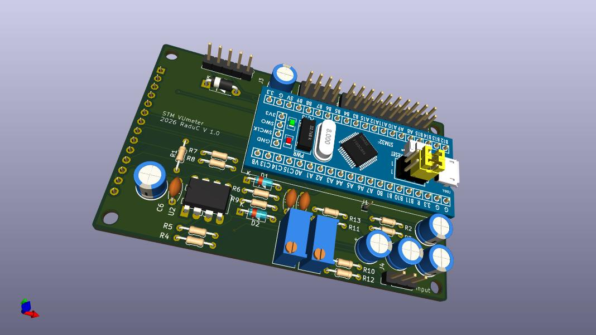

# Blue Pill STM32F103 VU Meter and Peak Meter

Stereo audio VU and peak meter firmware for an STM32F103C8T6 "Blue Pill" board and a 320×240 ILI9341 SPI TFT. The firmware samples two audio inputs with the STM32 ADCs and DMA, then displays smoothed VU levels and peak readings. It also includes optional sum/difference meters and a serial debug display mode.



## Features

- Stereo audio metering with VU ballistics and peak tracking.
- Selectable legacy `-40..+14 dB` and newer `-30..+14 dB` scales.
- Optional sum/difference meters and a simplified linear-value scale.
- Display backlight turns off after five minutes of silence.
- PCB manufacturing files, a schematic, and prebuilt firmware are in [`hardware/`](hardware/).

## Hardware

The project is configured for:

- STM32F103C8T6 Blue Pill.
- 320×240 ILI9341 SPI TFT.
- Left and right audio inputs at `PA0` and `PA1`.
- Startup display selection inputs at `PB5` and `PB4` (both use internal pull-ups).

The TFT connections used by the firmware are:

| TFT signal | Blue Pill pin |
|---|---|
| CS | `PA4` |
| DC | `PB14` |
| RESET | `PB13` |
| Backlight | `PA8` |
| SPI | Arduino core's default SPI pins |

Use the project schematic in [`hardware/vu_stm_sch.pdf`](hardware/vu_stm_sch.pdf) for the complete circuit and wiring. Do not connect audio signals directly to the MCU unless they are conditioned to remain within the STM32 ADC input range; follow the schematic.

### Startup modes

The firmware reads the two selector pins once during startup. `1` means the pin is high (normally left open); `0` means it is pulled low.

| `PB5` | `PB4` | Mode |
|---:|---:|---|
| 1 | 1 | Legacy `-40..+14 dB` scale with sum and difference meters |
| 1 | 0 | New `-30..+14 dB` scale |
| 0 | 1 | New scale with simplified linear-value labels |
| 0 | 0 | Legacy scale with sum and difference meters, plus debug information |

Set the selector levels before powering or resetting the board to change modes.

## Build and upload

Install [PlatformIO Core](https://platformio.org/install/cli) and ensure the board is connected to an ST-Link programmer. From the repository root:

```sh
pio run
pio run --target upload
```

The project environment is `bluepill_f103c8`; the configuration selects the STM32Duino Arduino core and ST-Link upload protocol. To build explicitly for this environment:

```sh
pio run --environment bluepill_f103c8
```

For the debug startup mode, open the serial monitor at 115200 baud:

```sh
pio device monitor --baud 115200
```

The prebuilt `firmware.bin` and `firmware.elf` files are provided in [`hardware/`](hardware/). Rebuilding from source is recommended when changing the firmware.

## Hardware files

- [`hardware/vu_stm_sch.pdf`](hardware/vu_stm_sch.pdf) — circuit schematic
- [`hardware/vu_stm_3d_pcb.jpg`](hardware/vu_stm_3d_pcb.jpg) — PCB 3D view
- [`hardware/vu_stm_gerber.zip`](hardware/vu_stm_gerber.zip) — PCB manufacturing files

## Repository layout

```text
src/         Firmware source and display driver
hardware/    Schematic, PCB files, and prebuilt firmware
include/     PlatformIO project headers
lib/         Project-specific libraries
test/        PlatformIO test directory
```

## Contributing and support

Bug reports and questions can be filed in the [GitHub Issues](https://github.com/Express1/blue_pill_vudisp_git/issues). Contributions are welcome; please include the board/display setup and the build or test results with changes.

## License

This project, including its firmware and hardware design files, is licensed under the GNU General Public License v3.0 or any later version. See [LICENSE](LICENSE) for the full license text.
